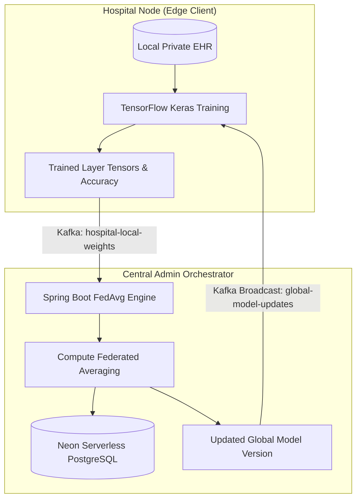

# Privacy-Preserving Healthcare Federated Learning Network


A decentralized, privacy-preserving machine learning architecture engineered to train deep learning neural networks across distributed hospital edge silos without centralizing sensitive electronic health records (EHR).

---

## 🏗️ Architecture & Asynchronous Event Flow



---

## 🔒 Key Highlights & Privacy Guarantees

* **Zero Raw Data Centralization:** Complies with strict healthcare governance regulations (HIPAA, GDPR, India DPDP Act). Patient records remain strictly behind hospital firewalls.
* **True Federated Averaging (FedAvg):** Mathematically aggregates multi-dimensional tensor weights weighted by client sample counts:
  $$\theta_{\text{global}}^{(t+1)} \leftarrow \sum_{k=1}^{K} \frac{n_k}{N} \theta_k^{(t)}$$
* **Event-Driven Polyglot Microservices:** Combines high-concurrency **Java Spring Boot** (participant registration, BCrypt password hashing, JWT stateless authentication, and Kafka stream orchestration) with **Python 3 / TensorFlow** for edge tensor training.
* **Resilient Persistence:** Tracks global model versions, accuracy progression, and audit logs using **Neon Serverless PostgreSQL**.
* **Interactive Web Administration Console:** Features a live dark-mode monitoring dashboard on `http://localhost:8080` displaying registered hospital nodes, training rounds, accuracy metrics, and manual round triggers.

---

## 🛠️ Technology Stack

* **Central Orchestrator:** Java 21, Spring Boot 3.3, Spring Security (BCrypt + JWT), Spring Data JPA, Neon PostgreSQL.
* **Event Broker:** Apache Kafka (`global-model-updates` & `hospital-local-weights`).
* **Edge ML Client:** Python 3.11, TensorFlow 2.x, Keras, Pandas, NumPy, Kafka-Python.
* **DevOps / CI/CD:** GitHub Actions (independent multi-runtime build matrix).

---

## 📁 Repository Structure

```text
privacy-preserving-healthcare-federated-learning/
├── admin-service/               # Java / Spring Boot Central Orchestration Node
│   ├── src/main/java/com/fl/admin/
│   │   ├── config/              # KafkaConfig, SecurityConfig (BCrypt, Stateless JWT)
│   │   ├── controller/          # AuthController, FederatedLearningController
│   │   ├── model/               # Hospital.java, GlobalModelVersion.java
│   │   ├── repository/          # HospitalRepository, GlobalModelVersionRepository
│   │   ├── security/            # JwtUtil, JwtAuthFilter
│   │   └── service/             # FederatedAggregationService (FedAvg Engine)
│   ├── src/main/resources/
│   │   └── static/              # Real-Time Web Console (index.html)
│   └── pom.xml
├── hospital-node/               # Python / TensorFlow Edge ML Client
│   ├── main.py                  # Local training loop & Kafka event listener
│   ├── generate_data.py         # Synthetic clinical EHR generator
│   ├── mock_patient_data.csv    # Private local patient dataset
│   ├── start_4_hospitals.bat    # Concurrent multi-node hospital simulation
│   └── requirements.txt
├── scripts/                     # Developer automation scripts
│   └── start_federated_orchestrator.bat
├── .github/workflows/           # Automated CI/CD workflows
│   └── ci-cd-pipeline.yml
├── .gitignore
├── LICENSE
└── README.md
```

---

## 🚀 Quick Start Guide

### 1. Launch the Java Admin Orchestrator
```bash
cd admin-service
mvn spring-boot:run
```
*The service boots up on `http://localhost:8080`, initializes the in-memory embedded Kafka broker on port `9092`, and connects to Neon PostgreSQL.*

### 2. Launch the Python Hospital Edge Node
```bash
cd hospital-node
python -m venv venv
# On Windows: venv\Scripts\activate | On Linux/macOS: source venv/bin/activate
pip install -r requirements.txt
python main.py
```
*The edge node connects to Kafka and begins listening for `global-model-updates`.*

### 3. Or Simulate 4 Concurrent Hospital Edge Nodes
```bash
cd hospital-node
.\start_4_hospitals.bat
```
*Simulates 4 independent hospitals (Apollo, AIIMS, Fortis, Max) training locally and streaming weights to Kafka concurrently.*

### 4. Execute a Federated Training Round

#### A. Register & Authenticate a Hospital Node
```bash
# Register hospital (passwords are securely hashed with BCrypt)
curl -X POST http://localhost:8080/api/auth/register \
  -H "Content-Type: application/json" \
  -d '{"name": "Delhi City Hospital", "email": "admin@delhihealth.org", "password": "secureHospitalPass123"}'

# Login to obtain signed JWT
TOKEN=$(curl -s -X POST http://localhost:8080/api/auth/login \
  -H "Content-Type: application/json" \
  -d '{"email": "admin@delhihealth.org", "password": "secureHospitalPass123"}' | jq -r .token)
```

#### B. Broadcast Training Signal
```bash
curl -X POST http://localhost:8080/api/fl/broadcast \
  -H "Authorization: Bearer $TOKEN"
```

#### C. Inspect Aggregated Global Model Versions in Neon PostgreSQL
```bash
curl -X GET http://localhost:8080/api/fl/versions \
  -H "Authorization: Bearer $TOKEN"
```

---

## 📡 API Reference Guide

| Endpoint | Method | Security | Description |
|---|---|---|---|
| `/api/auth/register` | `POST` | Public | Onboards a hospital node with BCrypt password hashing |
| `/api/auth/login` | `POST` | Public | Validates credentials and returns a signed 24h JWT |
| `/api/fl/broadcast` | `POST` | Bearer JWT | Dispatches training trigger to edge clients via Kafka |
| `/api/fl/versions` | `GET` | Bearer JWT | Returns history of aggregated global models and accuracies |
| `/api/fl/latest-model` | `GET` | Bearer JWT | Fetches the latest active global model version |

---

## 📄 License
This project is licensed under the MIT License - see the [LICENSE](LICENSE) file for details.
